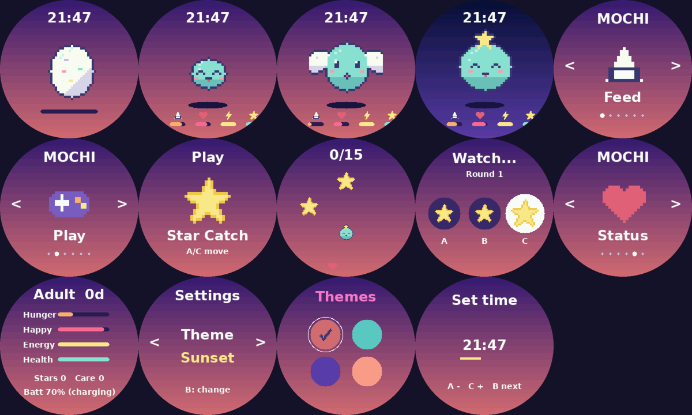
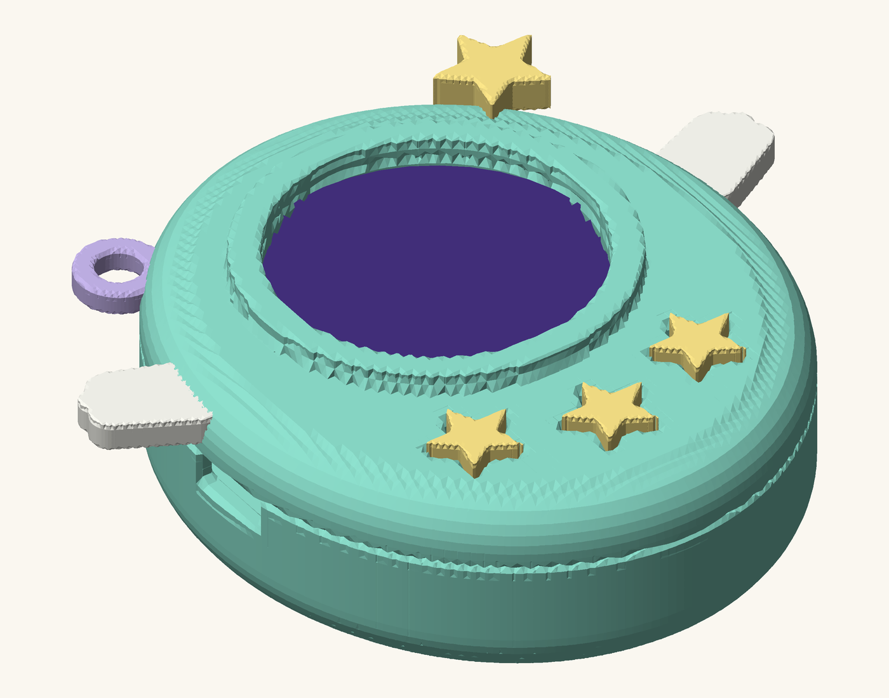
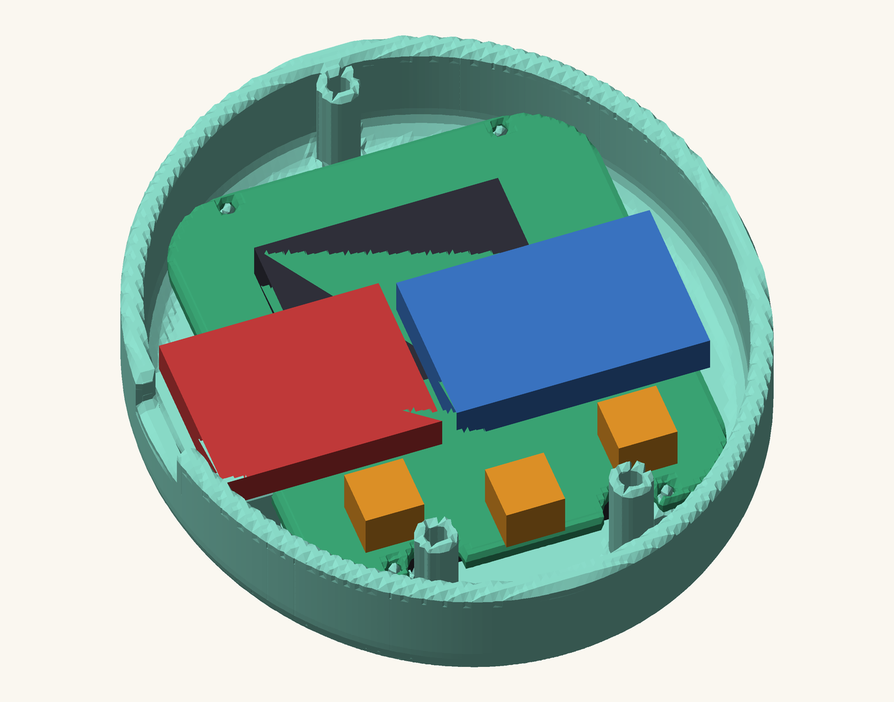

# MOCHI — Open Source Digital Pet

Mascota digital electrónica inspirada en los Tamagotchi clásicos: carcasa ovalada celeste con alas y estrellas, pantalla redonda a
color, tres botones con forma de estrella, batería recargable por USB-C y un firmware con ciclo de vida completo (huevo → bebé → niño →
joven → adulto en 3 formas).


*Capturas reales del código de interfaz del firmware ejecutado en el PC (`make snapshots`).* Sprites: `assets/sprites/ALL_pets_preview.png`.

## Estado del proyecto (leer primero)
| Área | Estado | Cómo se verificó |
|---|---|---|
| Núcleo de la mascota (estadísticas, sueño, evolución, eventos, guardado CRC, minijuegos) | ✅ completo y probado | 121 comprobaciones automáticas (`make test`), ASan/UBSan |
| Firmware ESP32-C3 (pantalla, botones, sonido, NVS, ahorro de energía, menús, minijuegos, temas, reloj) | ✅ escrito · ⚠️ **no compilado con PlatformIO ni probado en hardware** | compila sin avisos contra *stubs* de Arduino (`make syntax`); la interfaz se renderiza en el PC (`make snapshots`) |
| Sprites pixel-art originales (48 mascotas, 2 huevos, 10 iconos) | ✅ | generados por script y revisados |
| **Circuito con módulos ya hechos (sin PCB)** | ✅ diagramas + netlist verificada | `make netlist`; diagramas en `hardware/schematics/` |
| Carcasa 3D: **STL listos** (base, tapa, 3 botones) + renders | ✅ mallas cerradas, 0 aristas no-manifold · ⚠️ **sin imprimir todavía** | `make stl`, `make fit`, `make renders` |
| Código OpenSCAD de la carcasa | ✅ escrito · ⚠️ **no compilado** (sin OpenSCAD en el entorno de generación) | mismos parámetros que los STL |
| BOM y presupuesto | ✅ ≈ US$18.5 (precios orientativos, sin envío) | verificar proveedores |

**Medidas de componentes**: todas provisionales hasta confirmarlas con las piezas reales (`docs/manufacturing/measure_checklist.md`).
**Sin PCB**: el circuito se arma soldando módulos y componentes comunes (SuperMini + TP4056 + pantalla + bateria + buzzer + 3 pulsadores).




## Características
- Mascota animada con 8 emociones (neutral, feliz, hambrienta, triste, cansada, dormida, comiendo, enferma).
- Hambre, felicidad, energía y salud; sueño automático/manual; enfermedad y medicina (sin muerte: es un juguete).
- Evolución por tiempo de vida (huevo 2 min, bebé 6 h, niño 24 h, joven 72 h) y por calidad de cuidado: adulto **Ángel** (alas), **Estrella** o **Soñador** (gorro).
- Alimentos (onigiri, dango, baya), 2 minijuegos (**Atrapa estrellas**, **Mochi dice** con las 3 estrellas A/B/C), estrellas coleccionables.
- Reloj interno con eventos horarios (regalos, dolor de barriga), cumpleaños diario, recuperación acotada del tiempo apagado (máx. 6 h a medio ritmo).
- Guardado en flash (NVS) con CRC32 cada 5 min y tras acciones importantes; 4 temas de color (pantalla "Themes" como la referencia).
- Light sleep con pantalla apagada tras 20 s (despierta con cualquier botón).
- Controles: **A** izquierda/atrás · **B** aceptar (pulsación larga = inicio) · **C** derecha. En inicio: A menú, B acariciar, C luces/dormir.

## Circuito y componentes (ver `docs/electronics/architecture.md`)
ESP32-C3 SuperMini · pantalla redonda IPS GC9A01 240×240 (SPI) · módulo TP4056 con protección (**cambiar R_PROG a 10 kΩ**) · LiPo ~300 mAh ·
buzzer pasivo + BC547 · 3 pulsadores 6×6 mm (bajo las estrellas) · Schottky 1N5819. Un solo USB-C (el del SuperMini) programa y carga.
Cableado: `hardware/schematics/wiring_signals.png` y `wiring_power.png`. Lista: `hardware/BOM/MOCHI_BOM.csv`.

> **Desviación consciente del pedido**: se pidió pantalla OLED, pero la imagen de referencia muestra una pantalla redonda a color,
> así que se eligió un GC9A01 redondo. Si prefieres un OLED real, hay que cambiar el driver en `hal.cpp` y rehacer la interfaz.

## Instalación del firmware
```bash
pip install platformio
cd firmware && pio run -t upload          # conectar por USB-C; si no entra: mantener BOOT y pulsar RESET
# Para depurar evoluciones: añade -DMOCHI_FAST_AGING=60 a build_flags en platformio.ini (el tiempo corre x60)
```
Si cambias pines, edita `firmware/src/config.h` **y** `hardware/schematics/mochi_netlist.json` y ejecuta `make netlist`. Idioma de la interfaz: inglés
(fuentes ASCII incluidas en TFT_eSPI); los textos están en `firmware/src/ui.cpp`.

## Armado, impresión 3D
Guía paso a paso (con pruebas en protoboard primero): `docs/assembly/assembly.md`. Impresión: `docs/manufacturing/printing.md`.
Cambiar tamaños: edita `3d-models/source/params.scad` y ejecuta `make fit && make stl && make renders`.

## Pruebas (sin hardware)
```bash
make check        # núcleo + sintaxis de firmware + ajuste mecánico + circuito
make snapshots    # regenera docs/screens/*.png
make sprites      # regenera sprites y firmware/src/sprites.h
make stl          # regenera los STL (Python)
make renders      # regenera los renders 3D
make wiring       # regenera los diagramas de cableado
```
### Limitaciones conocidas
- Firmware no probado en el dispositivo; la API de TFT_eSPI/ledc depende de la versión del core (fijado: espressif32@6.5.0).
- El reloj se pierde si la batería se agota: se arranca desde el último instante guardado y se corrige en *Settings → Set time*.
- Autonomía (~4 días con 1 h/día de pantalla) es una estimación, no una medición.
- La interfaz es inglesa y usa fuentes bitmap integradas; no hay fuente pixel-art propia.
- Carcasa: sin pruebas de impresión; tolerancias de botones y pantalla requieren ajuste empírico. Los STL incluidos son de malla 0.5 mm (leve facetado: lijar).
- Los módulos de pantalla y TP4056 varían entre vendedores (orden de pines, tamaño): confirmar antes de soldar e imprimir.
- Al compartir el USB entre programación y carga, no conectes a la vez el USB propio del TP4056.
