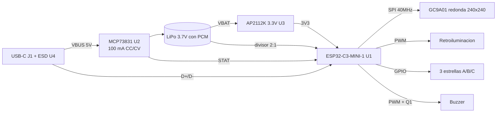

# Arquitectura electronica de MOCHI (rev A)

## Por que estas decisiones
- **ESP32-C3 en vez de ESP32 clasico**: 400 KB de RAM bastan para un framebuffer de 115 KB, USB nativo (sin chip USB-serie), modulo
  pequeno, bajo consumo en light sleep. La radio no se usa (reloj ajustado a mano).
- **Pantalla redonda GC9A01 a color en vez de OLED**: la imagen de referencia tiene pantalla redonda a color con temas. Un OLED
  monocromo/rectangular no reproduce ese diseno. El firmware aisla la pantalla en `hal.cpp` (TFT_eSPI); cambiarla es acotado.
- **Carga**: MCP73831 con R_PROG = 10 k => 100 mA = 0.33 C para 300 mAh (limite recomendado <= 0.5 C). Bateria con PCM obligatoria
  (proteccion de sobredescarga/sobrecorriente/cortocircuito); el MCP73831 no las incluye.
- **Alimentacion**: la bateria alimenta el LDO directamente (el dispositivo funciona mientras carga). Sin power-path ideal: al
  conectar USB con bateria muy descargada el equipo arranca desde la bateria. Mejora posible: BQ24074.

## Mapa de pines (coincide con `firmware/src/config.h`, verificado por `check_netlist.py`)
| GPIO | Senal | Notas |
|---|---|---|
| IO0 | BTN_A | pull-up 10k + 100 nF; despierta del light sleep |
| IO1 | BTN_B | idem |
| IO2 | VBAT_SENSE | divisor 100k/100k + 100 nF; estrapping (solo importa en modo descarga, con divisor ~2 V no molesta) |
| IO3 | BTN_C | idem |
| IO4 | TFT_BL | PWM 5 kHz via 100 ohm |
| IO5 | TFT_DC | |
| IO6 | TFT_SCLK | SPI |
| IO7 | TFT_MOSI | SPI |
| IO8 | libre | pull-up 10k (estrapping) |
| IO9 | BOOT | pull-up 10k + pulsador a GND |
| IO10 | TFT_CS | |
| IO18/IO19 | USB D-/D+ | USB nativo (programacion y logs) |
| IO20 | BUZZER | via R 100 + Q1 2N7002 |
| IO21 | CHG_STAT | STAT del MCP73831 (bajo = cargando) |
| EN | RESET | 10k + 1 uF + pulsador |
RST de la pantalla: pull-up a 3V3 (el controlador se reinicia por comando SWRESET).

## Presupuesto de energia (ESTIMADO; ver `hardware/tools/power_budget.py`)
Con 1 h/dia de pantalla: ~2.5 mA promedio => ~4 dias con 300 mAh. Pantalla siempre encendida: ~6 h. **Medir en el prototipo.**

## Verificaciones hechas (automaticas)
`python3 hardware/tools/check_netlist.py`: pines unicos y conectados, coincidencia con `config.h`, pull-ups de estrapping, desacoplo,
corriente de carga, rango del ADC. Ya encontro y corrigio un error real (condensador C10 sin conexion a GND).
## NO verificado todavia
Esquematico/PCB en KiCad (ERC/DRC), integridad de senal SPI en el PCB, consumo medido, antena, emisiones, ESD real.
