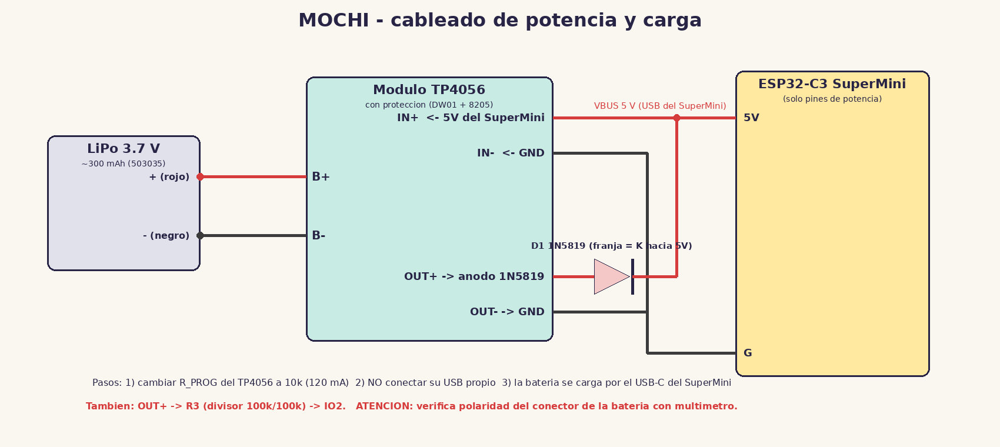
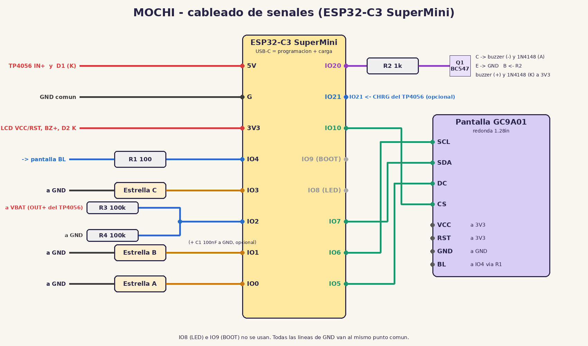
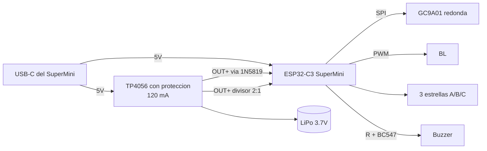

# Circuito de MOCHI rev B (modulos ya hechos, sin PCB)

## Decisiones
- **Un solo USB-C (el del SuperMini)** para programar y cargar. 5V del SuperMini alimenta la entrada del TP4056; la salida protegida del TP4056 vuelve al pin 5V del SuperMini a traves de un **Schottky 1N5819** (OR de diodos): con USB conectado manda el USB, sin USB manda la bateria, y la bateria nunca recibe 5 V por la ruta de alimentacion.
- **TP4056 con R_PROG = 10k (120 mA)**: la carga de 1 A de fabrica es 3.3 C para 300 mAh. La proteccion DW01 del modulo cubre sobredescarga, sobrecorriente y cortocircuito.
- **Costo del diodo**: ~0.3 V de caida; el LDO del SuperMini regula 3.3 V mientras VBAT >= ~3.8 V y luego el riel baja con la bateria; el C3 funciona hasta ~3.0 V, asi que se aprovecha la bateria hasta ~3.3 V (se pierde algo de capacidad en la cola).
- **Pantalla redonda GC9A01 a color** en vez de OLED: la referencia de diseno lo muestra asi (temas, color). Aislada en `firmware/src/hal.cpp`.
- **Botones sin componentes extra**: pull-ups internos + antirrebote por software (25 ms).
- **Buzzer con transistor**: los buzzers pasivos magneticos piden mas corriente de la que da un GPIO.

## Mapa de pines (coincide con `firmware/src/config.h`; lo verifica `make netlist`)
| GPIO | Senal | Conecta a |
|---|---|---|
| IO0 / IO1 / IO3 | BTN_A / BTN_B / BTN_C | pulsador a GND (estrellas izquierda/centro/derecha) |
| IO2 | VBAT_SENSE | divisor 100k/100k desde OUT+ del TP4056 (+100 nF opcional) |
| IO4 | TFT_BL | 100 ohm -> BL de la pantalla (PWM 5 kHz) |
| IO5 / IO6 / IO7 / IO10 | DC / SCL / SDA / CS | pantalla (SPI 40 MHz) |
| IO20 | BUZZER | 1k -> base BC547 |
| IO21 | CHG_STAT | CHRG del TP4056 (opcional) |
| 3V3 | - | pantalla VCC y RST, buzzer (+), 1N4148 (K) |
| IO8, IO9, IO18, IO19 | libres/reservados | LED, BOOT y USB nativo |

## Verificado automaticamente (`make netlist`)
Pines unicos y conectados, coincidencia con `config.h`, GPIO reservados sin usar, corriente de carga (0.40 C), excitador del buzzer (Ic ~74 mA < 100 mA), rango del ADC (2.1 V maximo).
## NO verificado
Consumo real, ruido del ADC, orden de pines de TU modulo de pantalla (los modulos varian), polaridad del conector de tu bateria, calor del TP4056 en la caja. Mide en el prototipo.
